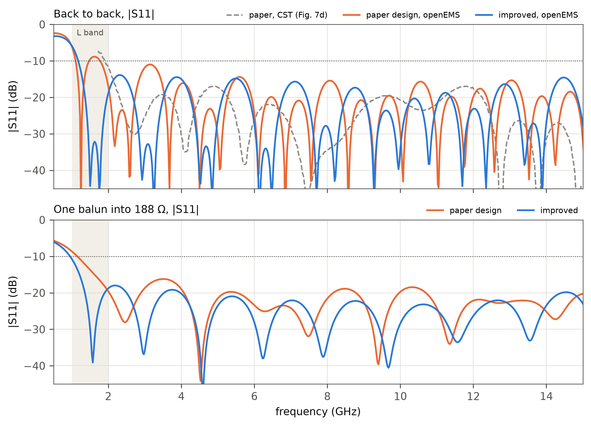

# Wideband microstrip to parallel strip balun, 1 to 15 GHz

Course project, EC301 RF Components and Circuits, NITK Surathkal (project 12, "Wideband BALUN circuit for L, S, C and X band applications").
Rushil Jain (241EC148) and Jainam Sonigara (241EC155).

A balun joins an unbalanced 50 Ω line to a balanced load. This project reproduces the tapered microstrip to parallel strip balun of Vinayagamoorthy, Coetzee and Jayalath (IEEE VTC 2012 Spring, doi 10.1109/VETECS.2012.6240118) in the FDTD solver [openEMS](https://www.openems.de), checks each result of the paper, and redesigns the taper so that the balun covers the whole L band on the same 70 mm × 18 mm board. The substrate is RT/duroid 5880 (εr = 2.2, h = 1.5748 mm) and the balun transforms 50 Ω to 188 Ω, the input impedance of a self-complementary spiral antenna.

## Results

Back to back, the paper design and the improved design, both in openEMS with the same settings:

| | paper, reported | paper design | improved |
|---|---|---|---|
| \|S11\| < −10 dB | 1.75 to 15 GHz | 1.78 to 15 GHz | 1.17 to 15 GHz |
| worst \|S11\|, 1.75 to 15 GHz | | −9.6 dB | −13.9 dB |
| lowest \|S21\|, 1.75 to 15 GHz | above −3 dB | −0.98 dB | −0.70 dB |
| strip current phase error | | 8.8° | 7.2° |
| common mode below differential mode | | 21.8 dB | 23.5 dB |

One balun into 188 Ω is matched (|S11| < −10 dB) from 1.15 GHz with the paper design and from 0.95 GHz with the improved taper. The paper's spiral antenna, simulated together with the paper design under it, is below −10 dB from 1.75 GHz to 15 GHz apart from −9.4 dB at 13.65 to 13.90 GHz (2.5 to 15 GHz measured in the paper). Its E-plane beamwidth is within 3.7° of Table III of the paper from 2 to 6 GHz, and its 10 GHz pattern follows the simulated pattern of Fig. 11 of the paper (front lobe 66.9° against 66.8°).



The paper design follows the impedances stated in Table I of the paper, Z = 50 (188/50)^(z/50) Ω from z = 5 mm to 50 mm, with the widths solved at every 0.5 mm by a quasi-static cross-section solver (`src/xsection.py`). The solver shows that two rows of Table I, at z = 29.8 mm and 41.5 mm, give 132 Ω and 140 Ω instead of the stated 110 Ω and 150 Ω; built exactly as printed, the balun has two extra reflection peaks near 5.8 and 6.9 GHz, which a transmission-line model built from the same solver also predicts.


The improved balun uses 60 of its 70 mm for a Klopfenstein taper (ripple 0.12, A = 2.393) and ends in 5 mm of 188 Ω parallel strip (0.786 mm strips). At each of 121 points the top strip width is solved from a table of the cross-section solver so that the line has the profile impedance, with the ground to strip width ratio falling as 1 + 2.75(1 − u)².


## Demo

```
python run_demo.py
```

This checks that openEMS and the result files are in place, then opens MATLAB with a window of buttons (`src/balun_demo.m`). One button opens the openEMS model of the improved balun with its mesh in AppCSXCAD. Two buttons build a coarse copy of the improved or the paper design (0.7 million cells instead of 3.1 million), run openEMS on it (about 3 minutes on 16 threads) and plot it over the saved full run. If the solver does not finish, the saved copy of the same coarse run in `results/` is plotted instead. The other buttons plot saved results: the 3D model, the paper comparison, a three-mesh check, Table I, current balance, the field in three cross-sections, the pulse moving through the balun, the spiral antenna, the impedance profiles and the effect of each change made to the paper design.

The runs behind the demo are written by `matlab -batch "build_demo"` after `python3 change_steps.py`; `export_movie.py` turns the time-domain dump of `movie_improved` into `results/movie_improved.mat`.

## Reproducing

Requirements: openEMS 0.37 (Windows build, in `C:\openEMS` or at `OPENEMS_DIR`), MATLAB, Python 3 with numpy, scipy, pandas, matplotlib, and h5py for the field and far-field files.

```
cd src
python3 make_geometry.py          # Table I outline as printed
python3 check_table1.py           # Table I check, solver check, impedance profile
python3 ztable.py                 # cross-section table for the synthesis (about 25 min)
python3 design_improved.py        # paper design, structure A, taper sweep, improved outline
matlab -batch "build_all"         # writes the openEMS models to %TEMP%\balun_sims
bash run_sims.sh                  # runs openEMS on every model
matlab -batch "post_all"          # S-parameters and strip currents to results/
python3 export_fields.py b2b_paper_B_stated b2b_improved
matlab -batch "build_antennas"    # spiral alone, and spiral with each balun under it
bash run_sims.sh spiral_lumped spiral_full spiral_full_improved
matlab -batch "post_spiral('spiral_full')"     # and the other two
python3 far_field.py spiral_full spiral_full_improved   # after nf2ff.exe nf2ff.xml in each run folder
python3 summarize.py              # results/summary.csv, spiral_numbers.csv, spiral_fig11.csv
python3 plots.py                  # results/figures/
```

The antenna models hold the spiral board and the balun board together, as in Fig. 9 of the paper, with a 50 Ω lumped port at the lower edge of the balun; each has about 20 million cells and runs for 1.7 hours on 16 threads. The far field is computed by `nf2ff.exe nf2ff.xml` in the run folder. The simulated 10 GHz pattern of Fig. 11 of the paper was read with `digitize_paper.py fig11`.

Windows runs processes started from a terminal without a window in efficiency mode, which slowed openEMS by a factor of four here; `src/no_throttle.ps1` turns that off for running openEMS processes.

A uniform 50 Ω line with the same port and mesh settings (`check_msl.m`) gives a line impedance of 50.9 to 53.2 Ω and |S11| below −31.7 dB from 1 to 15 GHz.

MATLAB R2025b reads the openEMS probe files only with `load -ascii`, so `src/ReadUI.m` is a copy of the openEMS function with that change. MATLAB's HDF5 reader cannot open the HDF5 2.x files that openEMS 0.37 writes, so field dumps and far fields are read in Python.

## Layout

```
teaching.md study guide: background theory, the paper, every simulation and result, the improvement, the demo
VIVA_PREP.md 5-minute presentation plan, demo order, answers to likely questions
Balun_quick_sheet.pdf  formulas, design choices, every band edge and result with where it comes from (source report/quick_sheet.md)
report/     also holds Wideband_Balun_Report.doc, the copy for submission
run_demo.py opens the demo in MATLAB
src/        openEMS models (MATLAB), cross-section solver, line model, synthesis, figures (Python)
geometry/   outline of every simulated structure: z, top width, bottom width (mm)
data/paper/ S11 curves of Figs. 7 and 10 and the 10 GHz pattern of Fig. 11, digitised from the paper
results/    S-parameters, strip currents, field maps, summary.csv, figures/
report/     report source (Markdown) and build script
slides/     presentation build script
```
