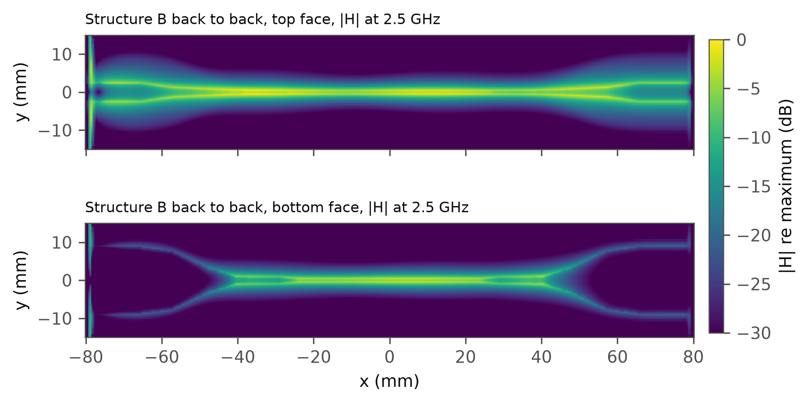
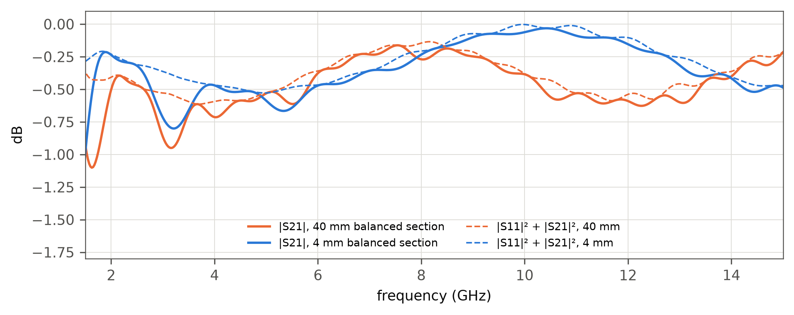
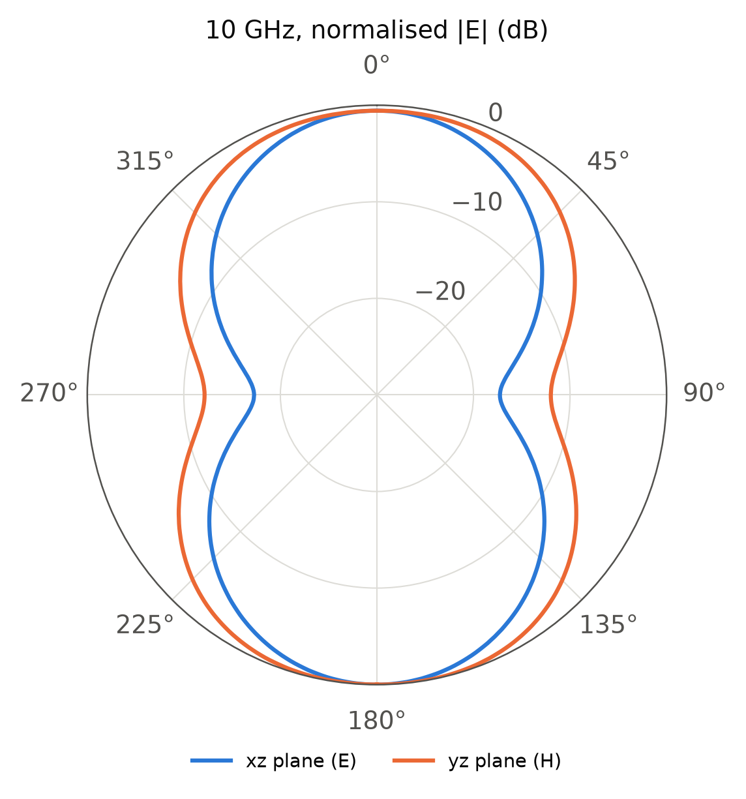

# Abstract

A balun joins an unbalanced line such as a coaxial cable or microstrip to a balanced load such as a dipole or a spiral antenna. This project reproduces the tapered microstrip to parallel strip balun of Vinayagamoorthy, Coetzee and Jayalath [1] in the open-source FDTD solver openEMS, and then redesigns its taper so that it covers the whole L band in the same board area. The balun is printed on RT/duroid 5880 ($\varepsilon_r = 2.2$, $h = 1.5748$ mm) and transforms 50 Ω to 188 Ω over 70 mm. We checked every dimension of the paper with a two-dimensional cross-section solver written for this project, simulated the back-to-back pair, the current balance, the field distribution, the effect of the balanced line length and the spiral antenna the paper feeds with the balun, and compared each with the published figures. Most published results are reproduced. The published dimensions give two reflection peaks near 5.8 GHz and 6.9 GHz that the paper does not show; we trace them to two rows of the paper's dimension table whose widths do not give the impedance the table states. The improved design follows a Klopfenstein impedance profile realised point by point with the cross-section solver. In the back-to-back test it keeps $|S_{11}|$ below $-10$ dB from 1.17 GHz to beyond 15 GHz, against 1.75 GHz in the paper, and a single balun into 188 Ω is matched from 0.95 GHz. Fed through the improved balun, the paper's spiral antenna is matched from 1.62 GHz to 15 GHz.

# Introduction

A balun converts between an unbalanced line, where one conductor is at ground potential, and a balanced line, where the two conductors carry equal and opposite currents. Dipoles, loops, spiral antennas, balanced mixers and push-pull amplifiers all need a balanced feed, while test equipment, coaxial cables and most planar circuits are unbalanced. If an antenna of this kind is connected straight to a coaxial cable, part of the current returns on the outside of the cable shield. That current radiates, tilts the pattern and makes the input impedance depend on how the cable is routed.

The project title asks for a balun that works across the L, S, C and X bands, which together run from 1 GHz to 12 GHz. A twelve-to-one bandwidth rules out the common narrowband baluns. A Marchand balun built from quarter-wave coupled lines covers about an octave, and a ferrite transformer balun is limited by core loss well before the microwave range. A tapered transition does not rely on a resonant length, so its upper frequency is set only by the precision of the geometry and the onset of higher-order modes, and its lower frequency by the length of the taper. That makes it the usual choice for frequency-independent antennas such as spirals.

We followed the course instructions: we chose a published paper with complete design data, reproduced its results with a simulation tool, and then tried to improve on them. The base paper [1] describes a microstrip to parallel strip balun on RT/duroid 5880 that matches 50 Ω to 188 Ω and reports a back-to-back return loss better than 10 dB from 1.75 GHz to 15 GHz. Our aim for the improvement was to bring the lower band edge down to 1 GHz, so that the whole L band is covered, without making the board larger.

# Base paper and design specification

In the paper [1] the balun feeds a two-arm Archimedean spiral. One end is a 50 Ω microstrip line for an SMA connector. Along the balun the ground plane under the strip narrows until it has the same width as the strip, so that the two conductors form a parallel strip line of 188 Ω, the input impedance of a self-complementary spiral. The authors designed the impedance profile as an exponential taper, chose the strip width from the microstrip formula and found the ground width at each point by a parameter sweep in CST Microwave Studio. They built two versions with the same top strip and different ground outlines, structures A and B, measured them back to back, and used structure B to feed the spiral. Table 1 lists the specification and Table 2 the dimensions of structure B.

Table: Table 1. Specification of the base design [1].

| quantity | value |
|---|---|
| substrate | RT/duroid 5880 |
| relative permittivity | 2.2 |
| substrate thickness | 1.5748 mm |
| unbalanced port | 50 Ω microstrip, SMA connector |
| balanced port | 188 Ω parallel strip |
| impedance profile | exponential, 50 Ω to 188 Ω |
| length × width of one balun | 70 mm × 18 mm |
| simulation tool used in [1] | CST Microwave Studio |
| reported band, structure B back to back | 1.75 to 15 GHz, return loss better than 10 dB |
| reported band, structure A back to back | 2 to 14.3 GHz |
| reported insertion loss, back to back | less than 3 dB |

Table: Table 2. Dimensions of structure B, Table I of [1]. $z$ is the distance from the 50 Ω end, $w$ the top strip width and $w'$ the bottom conductor width.

| $z$ (mm) | $w$ (mm) | $w'$ (mm) | stated impedance (Ω) |
|---:|---:|---:|---:|
| 5 | 4.8 | 18 | 50 |
| 12.7 | 2.6 | 16 | 70 |
| 22.2 | 1.76 | 7 | 90 |
| 29.8 | 1.2 | 2 | 110 |
| 41.5 | 1.1 | 1.8 | 150 |
| 46.2 | 0.92 | 0.98 | 170 |
| 50 | 0.88 | 0.88 | 188 |
| 70 | 0.88 | 0.88 | 188 |

The paper does not give every quantity a full-wave model needs. We filled the gaps as follows and kept these choices fixed for all runs.

* Loss tangent 0.0009 and copper conductivity $5.8 \times 10^7$ S/m with 35 µm thickness, from the substrate data sheet [7].
* Board width 30 mm, which leaves 6 mm of substrate on each side of the 18 mm ground.
* A 5 mm length of 50 Ω line between the board edge and the first table row, as in Fig. 3 of [1].
* The two baluns of the back-to-back test joined at $z = 70$ mm, so that the pair is 140 mm long with 40 mm of parallel strip in the middle.
* Widths joined by straight lines between table rows, as eq. (1) and Fig. 3 of [1] describe. A run with smooth curves through the same rows is reported in Section 5.3.
* Structure A drawn with a ground outline that narrows linearly from 18 mm to 0.88 mm between $z = 5$ mm and $z = 50$ mm. The paper shows structure A only in a photograph, Fig. 7(b), where the ground edges are close to straight.
* SMA connectors left out. The microstrip ports are de-embedded to the board edges.

The paper reports the following results, and Section 5 checks each of them: the impedance of each row of Table 2, the back-to-back $|S_{11}|$ and $|S_{21}|$ of structures A and B (Fig. 7), the 180° phase difference between the currents in the two strips (Fig. 5), the symmetric surface current at 2.5 GHz (Fig. 6), the unchanged response when the balanced section is lengthened, and the input reflection and beamwidths of the spiral antenna fed by the balun (Figs. 10 and 11, Table III).

# Theory

## Microstrip and parallel strip lines

A microstrip line is a strip of width $w$ on a dielectric of thickness $h$ over a ground plane much wider than the strip. The field lies mostly in the dielectric under the strip, and the ground carries the return current in a band just below it. For a ground of unlimited width the closed-form expressions of Hammerstad and Jensen [4] give the characteristic impedance $Z_0$ and the effective permittivity $\varepsilon_{\text{eff}}$ to better than one per cent. On RT/duroid 5880 of 1.5748 mm thickness a 50 Ω line is 4.85 mm wide.

A parallel strip line has two strips of equal width on opposite faces of the substrate. By symmetry the plane midway between them is at zero potential, so each half behaves as a microstrip of thickness $h/2$, and

$$ Z_{\text{ps}}(w, h) = 2\, Z_{\text{ms}}(w, h/2). $$

The currents in the two strips are equal and opposite, which is the balanced mode. With $w = 0.88$ mm this gives 180 Ω.

The value of 188 Ω comes from the load. A two-arm self-complementary antenna, whose metal and slot shapes are identical, has an input impedance of $\eta_0/2 \approx 188$ Ω in free space, independent of frequency [8]. The Archimedean spiral of [1] has arm width equal to arm spacing and is self-complementary.

## The tapered transition

At the 50 Ω end of the balun the ground is wide and the line is a microstrip, so the field is unbalanced and the ground current spreads under the strip. At the other end the two conductors are equal and the line carries only the balanced mode. Narrowing the ground gradually turns one mode into the other, and changing both widths at the same time changes the line impedance from 50 Ω to 188 Ω. Each cross-section along the taper is a two-conductor line, so it supports one quasi-TEM mode with a definite impedance $Z(z)$ and effective permittivity $\varepsilon_{\text{eff}}(z)$. The balun therefore behaves as a nonuniform transmission line, and its reflection can be predicted from $Z(z)$.

## Reflection from a taper

For a slowly varying line the theory of small reflections [2] gives the input reflection coefficient as

$$ \Gamma(f) = \frac{1}{2} \int_0^L e^{-2j\phi(z)} \, \frac{d}{dz} \ln Z(z) \, dz, \qquad \phi(z) = \int_0^z \frac{2\pi f}{c} \sqrt{\varepsilon_{\text{eff}}(z')} \, dz'. $$

Every place where $\ln Z$ changes quickly reflects, and reflections from different places add with the phase of the round trip between them. For an exponential taper, $Z(z) = Z_0 \exp\left[(z/L) \ln(Z_L/Z_0)\right]$, the integral gives

$$ |\Gamma| = \frac{1}{2} \ln\frac{Z_L}{Z_0} \left| \frac{\sin \beta L}{\beta L} \right| . $$

With $Z_L/Z_0 = 188/50$ the factor $\frac{1}{2}\ln(Z_L/Z_0)$ is 0.662, so $|\Gamma|$ falls below 0.316 ($-10$ dB) once $\beta L \geq 1.95$. For the 45 mm taper of [1] and $\varepsilon_{\text{eff}} \approx 1.8$ this happens at 1.54 GHz, close to the lower band edge the paper reports.

The Klopfenstein taper [3] is the profile that gives the lowest passband reflection for a given length. Its impedance is

$$ \ln Z(z) = \frac{1}{2}\ln(Z_0 Z_L) + \frac{\Gamma_0}{\cosh A} A^2 \, \varphi\!\left(\frac{2z}{L} - 1, A\right), \qquad \varphi(x, A) = \int_0^x \frac{I_1\left(A\sqrt{1-y^2}\right)}{A\sqrt{1-y^2}} \, dy, $$

where $\Gamma_0 = \frac{1}{2}\ln(Z_L/Z_0)$, $I_1$ is the modified Bessel function of the first kind and the constant $A$ follows from the chosen passband ripple $\Gamma_m$ through $\cosh A = \Gamma_0/\Gamma_m$. The reflection is

$$ \Gamma(\beta L) = \Gamma_0 \, e^{-j\beta L} \, \frac{\cos\sqrt{(\beta L)^2 - A^2}}{\cosh A}, $$

which stays at or below $\Gamma_m$ for all $\beta L \geq A$. The profile has small impedance steps of $\Gamma_m$ at both ends.

## Back-to-back measurement

A balun cannot be measured directly on a two-port network analyser because one of its ports is balanced. The usual method, which [1] also uses, joins two identical baluns at their balanced ends and measures the pair between its two unbalanced ports. The test is strict: if one balun reflects $\Gamma_1$, the reflections of the two baluns arrive with opposite sign and a delay set by the line between them, so that

$$ |S_{11}| \approx |\Gamma_1| \, \left|1 - e^{-2j\beta d}\right| \leq 2|\Gamma_1|, $$

where $d$ is the electrical distance between the two tapers. A single balun with $|\Gamma_1| = -16$ dB can therefore produce a back-to-back peak of $-10$ dB. The insertion loss of the pair is twice that of one balun.

# Tools and method

## openEMS

The full-wave simulations use openEMS [5], an open-source solver based on the finite-difference time-domain method of Yee [6]. The electric and magnetic fields are updated in turn on a staggered rectangular grid, and a single run with a Gaussian pulse gives the response over the whole band. We drove openEMS from MATLAB R2025b through its MATLAB interface: a script writes the geometry, materials, mesh and ports to a model file, the solver runs on that file, and a second script reads the port and probe signals and computes the S-parameters with a Fourier transform. The geometry comes from a table of $(z, w, w')$ points, so every structure in this report is built by the same code.

Table: Table 3. Simulation settings.

| item | setting |
|---|---|
| excitation | Gaussian pulse, 0.5 to 16 GHz |
| conductors | 35 µm copper, $\sigma = 5.8 \times 10^7$ S/m, as conducting sheets |
| substrate | $\varepsilon_r = 2.2$, loss tangent 0.0009 at 10 GHz |
| mesh across the strips | 0.08 mm within 1.4 mm of the centre line, 0.15 mm to 2.6 mm, 0.3 mm over the ground flare |
| mesh along the line | 0.4 mm, about one thirty-fourth of the wavelength in the substrate at 15 GHz |
| mesh through the substrate | six cells |
| grading | at most 1.3 between neighbouring cells |
| boundaries | 8-cell perfectly matched layer [9], 20 mm of air around the board |
| ports | microstrip ports referred to the board edges; 188 Ω lumped port for a single balun |
| stopping rule | field energy 50 dB below its peak |
| model size and time | 1.5 to 3.2 million cells, 5 to 10 minutes on 16 threads |

Besides the S-parameters, every model records the current in the top and the bottom strip at the middle of the balanced section, by integrating the magnetic field around each strip, and the magnetic field just outside both conductors at chosen frequencies.

## Cross-section solver

To check the impedances of Table 2 and to design the improved taper we wrote a quasi-static solver for the balun cross-section. It solves Laplace's equation by finite differences on a graded grid that extends 25 times the largest width in every direction, once with the substrate and once in air. From the two solutions it forms the capacitance matrix of the two strips, takes equal and opposite charges on them, and gets the line capacitance $C$ and its value in air $C_a$. Then

$$ Z_0 = \frac{1}{c\sqrt{C\,C_a}}, \qquad \varepsilon_{\text{eff}} = \frac{C}{C_a}. $$

Table 4 compares the solver with closed-form results. It agrees to between 0.6 and 1.2 per cent, and the small offset in the same direction in every case comes from the finite size of the grid.

Table: Table 4. Cross-section solver against closed-form expressions [4].

| line | $Z_0$ solver (Ω) | $Z_0$ closed form (Ω) | $\varepsilon_{\text{eff}}$ solver | $\varepsilon_{\text{eff}}$ closed form |
|---|---:|---:|---:|---:|
| microstrip, $w$ = 4.8 mm | 50.11 | 50.42 | 1.883 | 1.880 |
| microstrip, $w$ = 2.6 mm | 72.84 | 73.45 | 1.818 | 1.816 |
| microstrip, $w$ = 1.2 mm | 106.19 | 107.33 | 1.757 | 1.753 |
| parallel strip, $w$ = 0.88 mm | 178.08 | 180.19 | 1.784 | 1.781 |

## Transmission-line model

With $Z(z)$ and $\varepsilon_{\text{eff}}(z)$ from the cross-section solver, the taper is cut into uniform sections 0.25 mm to 0.5 mm long and their ABCD matrices are multiplied. This gives the S-parameters of one balun or of the back-to-back pair in a fraction of a second. It ignores radiation and higher-order modes, but Section 5.3 shows that it predicts the full-wave reflection of the balun closely, which made it useful for exploring designs before running openEMS.

## Check of the setup

Before the balun runs we simulated a 40 mm uniform 50 Ω microstrip line over an 18 mm ground with exactly the same port, mesh and material settings. Between 1 GHz and 15 GHz the port reports a line impedance of 50.9 Ω to 53.2 Ω, which rises slowly with frequency as microstrip dispersion predicts, $|S_{11}|$ stays below $-31.7$ dB and $|S_{21}|$ stays within 0.12 dB of 0 dB.

# Validation of the base paper

## Impedance of the published cross-sections

Table 5 gives the impedance of each row of Table 2 from the cross-section solver. Four rows are within 5 per cent of the stated value, and the two parallel strip rows are 5.3 per cent low. The row at $z = 29.8$ mm gives 132.5 Ω instead of 110 Ω. With a top strip of 1.2 mm, a bottom conductor of about 6.3 mm would be needed for 110 Ω, so the bottom width of 2 mm is too narrow by a factor of three. The row at $z = 41.5$ mm gives 139.9 Ω instead of 150 Ω. The parallel strip of 0.88 mm gives 178 Ω instead of 188 Ω; 188 Ω needs strips of 0.786 mm.

Table: Table 5. Impedance of the published cross-sections from the cross-section solver.

| $z$ (mm) | $w$ (mm) | $w'$ (mm) | stated (Ω) | computed (Ω) | difference |
|---:|---:|---:|---:|---:|---:|
| 5 | 4.8 | 18 | 50 | 50.6 | +1.2 % |
| 12.7 | 2.6 | 16 | 70 | 73.4 | +4.9 % |
| 22.2 | 1.76 | 7 | 90 | 92.3 | +2.5 % |
| 29.8 | 1.2 | 2 | 110 | 132.5 | +20.5 % |
| 41.5 | 1.1 | 1.8 | 150 | 139.9 | −6.7 % |
| 46.2 | 0.92 | 0.98 | 170 | 171.4 | +0.8 % |
| 50 and 70 | 0.88 | 0.88 | 188 | 178.1 | −5.3 % |

## Structure B back to back

The outline of the simulated boards is drawn in the first figure below. The second figure compares the back-to-back S-parameters of structure B from openEMS with the simulated and measured curves of Fig. 7(d) of [1], which we digitised from the paper.

![Structure B back to back: openEMS result with the published dimensions, and the simulated (CST) and measured $|S_{11}|$ of Fig. 7(d) of [1].](../results/figures/fig_b2b_paper_B.png)

Below 5 GHz and above 7.5 GHz the openEMS curve follows the paper closely. The rise to $-6$ dB near 1.6 GHz, the crossing of $-10$ dB at 1.9 GHz and the ripple level of $-12$ dB to $-18$ dB in the rest of the band all match the paper's CST curve, whose own crossing of $-10$ dB is at about 1.9 GHz. The 1.75 GHz figure in the paper comes from the measured board. Between 5.42 GHz and 6.10 GHz our result rises to $-6.7$ dB, and between 6.78 GHz and 7.10 GHz to $-9.1$ dB. Over the band the paper claims, 1.75 GHz to 15 GHz, $|S_{11}|$ is below $-10$ dB on 90.8 per cent of the frequencies. $|S_{21}|$ is never lower than $-1.89$ dB over the same band, and never lower than $-1.15$ dB at the frequencies where $|S_{11}|$ is below $-10$ dB, so the insertion loss of the pair is below the 3 dB the paper reports.

## Source of the two reflection peaks

The transmission-line model of Section 4.3 gives the reflection of the published outline from its impedance profile alone. The figure below compares it with openEMS. The two agree on the position and height of every peak up to 8 GHz, including those at 5.8 GHz and 6.9 GHz, so the peaks come from the impedance profile and not from the way the structure is modelled.

The profile in the figure of Section 5.1 shows why. Between $z = 22$ mm and $z = 30$ mm the impedance rises from 92 Ω to 132 Ω, and between $z = 41$ mm and $z = 47$ mm from 140 Ω to 171 Ω. These two fast rises are 18 mm apart. Their reflections add in phase when the round trip between them is one wavelength, at

$$ f = \frac{c}{2 \times 18\ \text{mm} \times \sqrt{1.8}} \approx 6.2\ \text{GHz}, $$

which is where the single balun reflects most strongly. In the back-to-back pair this reflection appears twice and gives the peaks at 5.8 GHz and 6.9 GHz. Both rises come from the two table rows whose widths do not give the stated impedance. The paper's CST model and its measured board do not show the peaks, so they were most likely built with outlines closer to the exponential law than the printed table. Drawing the published rows with smooth curves instead of straight lines does not remove the peaks: that run gives 89.3 per cent of the band below $-10$ dB.

## Structure A

Structure A has the same top strip with a straight ground outline. The paper reports a back-to-back band of 2 GHz to 14.3 GHz, with simulated peaks of about $-13$ dB at 3.3 GHz and 4.8 GHz. Our model of structure A has its two peaks at 3.02 to 3.68 GHz ($-7.0$ dB) and 5.55 to 6.12 GHz ($-7.7$ dB), and $|S_{11}|$ is below $-10$ dB on 90.4 per cent of the 1.75 GHz to 15 GHz band. The first peak is at the frequency the paper shows. The outline of structure A is our assumption, so we treat this comparison as qualitative. The paper finds structure B better than A; in our simulation the two meet the $-10$ dB limit over almost the same share of the band, 90.8 and 90.4 per cent, and do not separate as clearly.

![Structure A back to back: openEMS result and the simulated and measured $|S_{11}|$ of Fig. 7(c) of [1].](../results/figures/fig_b2b_paper_A.png)

## Current balance

The paper checks the balance with two magnetic field probes, one at each strip of the balanced section, and shows a phase difference of 180° from 1.75 GHz to 15 GHz (Fig. 5 of [1]). We recorded the total current in each strip at the junction of the back-to-back pair. Over 1.75 GHz to 15 GHz the phase difference of the published design stays within 13.8° of 180° and the amplitudes within 1.74 dB of each other. Writing the strip currents as a differential part $I_d = (I_{\text{top}} - I_{\text{bot}})/2$ and a common-mode part $I_c = (I_{\text{top}} + I_{\text{bot}})/2$, the common-mode current is at least 17.6 dB below the differential current everywhere in the band. The balance figure in Section 6.3 shows both designs.

## Surface current at 2.5 GHz

Fig. 6 of [1] shows the surface current on the balun at 2.5 GHz, symmetric about the centre line. The figure below shows the magnitude of the magnetic field one cell above the top conductor and one cell below the bottom conductor of structure B back to back, which follows the surface current. The distribution is symmetric about the centre line. On the wide part of the ground the current is concentrated under the strip, as on a microstrip. As the ground narrows the current moves to its edges, and in the balanced section the two faces carry the same distribution.

## Length of the balanced section

The paper reports that the S-parameters do not change when the balanced section between the two baluns is made longer or shorter, and takes this as evidence that the balun suppresses the common mode. We simulated the published design with 40 mm and with 4 mm of parallel strip between the baluns. $|S_{11}|$ changes with the length, because the reflections of the two tapers meet with a different phase, and in the published design those reflections are large enough for this to matter. The quantity that common-mode current would change is the power that leaves the line by radiation. The figure below shows $|S_{21}|$ and $|S_{11}|^2 + |S_{21}|^2$ for both lengths. The two curves of $|S_{11}|^2 + |S_{21}|^2$ agree within about 0.2 dB across the band. Both dip to about $-1$ dB near 4.5 GHz to 5 GHz, where the tapers themselves radiate, and above 10 GHz the long version is about 0.2 dB lower, which is the loss of the extra 36 mm of line. A longer balanced section adds no radiation of its own, which agrees with the paper's conclusion.

## Spiral antenna fed by the balun

In [1] the balun feeds a two-arm Archimedean spiral on a 60 mm × 60 mm board of the same substrate. The arm width, the gap between arms and the inner radius are all 0.86 mm, the outer radius is 28.3 mm and each arm has eight turns. The paper reports a measured return loss better than 10 dB from 2.5 GHz to 15 GHz at the 50 Ω connector (Fig. 10), the pattern at 10 GHz (Fig. 11) and the half-power beamwidths in two planes from 2 GHz to 15 GHz (Table III).

We first built a model of the complete antenna, with the balun board standing under the spiral and its two strips passing through the spiral board to the arm ends. That model showed a reflection of about $-5$ dB at the junction, repeating every 1.75 GHz, which is the round trip along the balun. The paper shows this junction only in a photograph, so our version of it is a guess, and we did not use that model further. Instead we simulated the spiral on its own, fed by a 188 Ω lumped port across the gap between the two arm ends (2.8 million cells, 0.25 mm mesh across the spiral), and simulated each balun as a two-port with a 50 Ω port at the unbalanced end and a 188 Ω port at the balanced end, driving each port in turn. The input reflection of the antenna at its connector then follows from

$$ \Gamma_{\text{in}} = S_{11} + \frac{S_{12} S_{21} \Gamma_L}{1 - S_{22} \Gamma_L}, $$

where $\Gamma_L$ is the reflection of the spiral referred to 188 Ω. The two balun runs give $|S_{12}|$ and $|S_{21}|$ within 0.26 dB of each other from 2 GHz to 15 GHz, as reciprocity requires.

On its own the spiral is matched to 188 Ω: $|S_{11}|$ is below $-10$ dB from 1.65 GHz upward and below $-12$ dB from 2 GHz to 14 GHz, with an input resistance of 140 Ω to 200 Ω. The lower limit agrees with the 1.69 GHz at which the paper puts the largest arm circumference at one wavelength. The figure below compares the antenna fed by the published balun with Fig. 10 of [1]. From 2 GHz to 5 GHz it follows the measured curve closely, including the deep minimum near 3.5 GHz. It is below $-10$ dB on 85.6 per cent of the 2.5 GHz to 15 GHz band, and rises to $-8.0$ dB between 5.42 GHz and 6.32 GHz, the band of the balun's own reflection peaks, and to $-9.0$ dB between 13.28 GHz and 14.12 GHz.

![Input $|S_{11}|$ of the spiral antenna at the 50 Ω connector with the published and with the improved balun, the spiral alone referred to 188 Ω, and the simulated and measured curves of Fig. 10 of [1].](../results/figures/fig_spiral_s11.png)

Table: Table 6. Half-power beamwidth of the spiral in the xz plane (E) and the yz plane (H): Table III of [1], our total field, and our $E_\theta$ component alone.

| $f$ (GHz) | [1], E | [1], H | total, E | total, H | $E_\theta$, E | $E_\theta$, H |
|---:|---:|---:|---:|---:|---:|---:|
| 2 | 94.6° | 81.8° | 95.6° | 94.9° | 81.9° | 82.3° |
| 2.5 | 93.5° | 78.5° | 92.8° | 93.2° | 80.8° | 81.2° |
| 3 | 86.4° | 78.3° | 87.5° | 87.6° | 78.7° | 79.2° |
| 4 | 73.3° | 70.2° | 79.3° | 78.6° | 75.7° | 76.0° |
| 5 | 64.9° | 67.1° | 71.3° | 75.0° | 72.5° | 76.8° |
| 6 | 61.0° | 60.7° | 68.2° | 71.3° | 71.1° | 73.3° |
| 10 | 53.8° | 47.3° | 62.6° | 93.3° | 67.4° | 102.1° |
| 15 | 42.6° | 34.4° | 109.9° | 74.8° | 114.5° | 67.4° |

With the total field, our xz-plane beamwidth agrees with the paper's E-plane within 1.1° from 2 GHz to 3 GHz. From 4 GHz to 10 GHz both narrow with frequency at about the same rate, ours staying 6° to 9° wider. Our H-plane is 9° to 15° wider than the paper's below 4 GHz. The paper measured with a linearly polarised horn and does not say which field component, so the table also gives the beamwidth of $E_\theta$ alone, whose H-plane values are within 0.5° to 6° of the paper up to 4 GHz. At 10 GHz in the H-plane and at 15 GHz in both planes the model departs from the paper. At 15 GHz the radiating part of the spiral has a radius of about 3 mm, roughly a dozen mesh cells, which the 0.25 mm mesh does not resolve well, so we do not count these values as reproduced. The pattern at 10 GHz has its maxima along the spiral axis on both sides and minima in the plane of the spiral, as in Fig. 11 of [1]. The peak directivity rises from 3.6 dBi at 2 GHz to 5.8 dBi at 6 GHz to 10 GHz.

## Summary of the validation

Table: Table 7. Results of [1] and the corresponding results of this project.

| result in [1] | value in [1] | this project | outcome |
|---|---|---|---|
| impedance of the table rows | 50 to 188 Ω, exponential | 4 rows within 5 %, parallel strip 5.3 % low, rows at 29.8 and 41.5 mm off by +20.5 % and −6.7 % | reproduced, two rows inconsistent |
| structure B back to back, $\lvert S_{11}\rvert < -10$ dB | 1.75 to 15 GHz | 1.9 to 15 GHz except 5.42 to 6.10 and 6.78 to 7.10 GHz; 90.8 % of the band | reproduced except two peaks, cause identified |
| insertion loss back to back | below 3 dB | below 1.89 dB | reproduced |
| structure A back to back | 2 to 14.3 GHz | 90.4 % of 1.75 to 15 GHz, first peak at the same frequency | reproduced qualitatively |
| structure B better than A | yes | 90.8 % against 90.4 % of the band | not clearly reproduced |
| phase difference of strip currents | 180° | 180° ± 13.8°, common mode at least 17.6 dB down | reproduced |
| surface current at 2.5 GHz | symmetric | symmetric | reproduced |
| longer balanced section | no change | no change in loss; $\lvert S_{11}\rvert$ ripple moves | reproduced |
| spiral antenna, $\lvert S_{11}\rvert < -10$ dB | 2.5 to 15 GHz, measured | 85.6 % of the band; peaks of −8.0 and −9.0 dB at 5.42 to 6.32 and 13.28 to 14.12 GHz; measured curve followed from 2 to 5 GHz | reproduced except the balun's peak band |
| spiral beamwidths | Table III, 2 to 15 GHz | E-plane within 1.1° at 2 to 3 GHz, 6° to 9° wider to 10 GHz; H-plane 9° to 15° wider; 15 GHz not resolved | partly reproduced |

# Improved design

## Aim

The base design reaches 1.75 GHz, so it covers only the top of the L band (1 GHz to 2 GHz), and the published dimensions leave two reflection peaks between 5 GHz and 7.5 GHz. We set out to cover 1 GHz to 15 GHz with the same substrate, the same 70 mm × 18 mm board per balun, the same 5 mm feed line for the connector and a 188 Ω balanced output.

## Design

Two changes come from the analysis above. The first is to use more of the 70 mm for the taper. In [1] the taper is 45 mm long and is followed by 20 mm of parallel strip, which has no effect on matching. We made the taper 60 mm long and kept 5 mm of parallel strip at the balanced end. The second is to use the Klopfenstein profile in place of the exponential one, because for the same length it reaches a lower frequency with a lower passband reflection.

The taper was then realised point by point. We tabulated the cross-section solver over top widths from 0.4 mm to 6 mm and bottom widths from 0.4 mm to 24 mm, 780 cross-sections in all, and interpolated in that table. The ratio of bottom to top width is set to fall smoothly from 3.75, the ratio of the 18 mm ground to the 4.8 mm strip at the feed, to 1 at the balanced end:

$$ r(u) = \frac{w'}{w} = 1 + 2.75\,(1 - u)^2, \qquad u = \frac{z - 5\ \text{mm}}{60\ \text{mm}} . $$

At each of 121 points along the taper the top width $w$ is solved so that the cross-section with $w' = r w$ has the Klopfenstein impedance at that point. The squared form makes the ground narrow fastest near the feed, where the ground is much wider than the strip and changes in its width hardly affect the impedance. Every point of the result has the intended impedance, the top strip narrows monotonically, the ground is never narrower than the strip, and the narrowest conductor is the 0.786 mm parallel strip of 188 Ω.

The taper length and the ripple $\Gamma_m$ were chosen with the transmission-line model. Table 8 lists part of that sweep. A longer taper always lowers the band edge. A larger ripple lowers it as well, at the cost of a higher reflection in the band. We chose a 60 mm taper with $\Gamma_m = 0.12$ ($-18.4$ dB, $A = 2.393$): the model predicts a back-to-back edge of 1.25 GHz and a single-balun edge of 1.05 GHz.

Table: Table 8. Transmission-line model of Klopfenstein tapers of different length and ripple: lowest frequency from which $|S_{11}|$ stays below $-10$ dB up to 15 GHz.

| taper length | $\Gamma_m$ | back to back | one balun into 188 Ω |
|---:|---:|---:|---:|
| 45 mm | 0.10 | 1.85 GHz | 1.45 GHz |
| 45 mm | 0.12 | 1.25 GHz | 1.40 GHz |
| 55 mm | 0.12 | 1.25 GHz | 1.15 GHz |
| 60 mm | 0.10 | 1.30 GHz | 1.10 GHz |
| 60 mm | 0.12 | 1.25 GHz | 1.05 GHz |
| 60 mm | 0.15 | 1.20 GHz | 1.00 GHz |

Table: Table 9. Dimensions of the improved balun at selected points. The full outline, 125 points, is in the project files.

| $z$ (mm) | $w$ (mm) | $w'$ (mm) | impedance (Ω) |
|---:|---:|---:|---:|
| 0 to 5 | 4.80 | 18.00 | 50.6 |
| 5 | 4.08 | 15.29 | 56.4 |
| 15 | 3.32 | 9.67 | 64.9 |
| 25 | 2.57 | 5.72 | 78.3 |
| 35 | 2.00 | 3.37 | 97.0 |
| 45 | 1.58 | 2.06 | 120.1 |
| 55 | 1.26 | 1.35 | 144.8 |
| 65 | 1.01 | 1.01 | 166.7 |
| 65 to 70 | 0.786 | 0.786 | 188 |

![Impedance along the balun: the exponential law of [1], the published outline and the improved Klopfenstein design.](../results/figures/fig_profiles.png)

## Results

The improved design was simulated in openEMS with exactly the settings used for the paper's structures, both back to back and as a single balun closed by a 188 Ω port, which stands for the spiral. The figure below compares it with the published design and with the paper's own CST result, and Table 10 lists the figures of merit.

![$|S_{11}|$ of the published design and of the improved design. Top: back to back, with the CST result of [1]. Bottom: one balun into 188 Ω. The shaded strip is the L band.](../results/figures/fig_compare.png)

Table: Table 10. Published design and improved design, both simulated in openEMS with the same settings, and the band reported in [1].

| quantity | [1], reported | published dimensions | improved |
|---|---|---|---|
| back to back, $\lvert S_{11}\rvert < -10$ dB from | 1.75 GHz | 7.12 GHz (1.9 GHz with two gaps) | 1.17 GHz |
| back to back, share of 1.75 to 15 GHz below $-10$ dB | not stated | 90.8 % | 100 % |
| back to back, worst $\lvert S_{11}\rvert$, 1.75 to 15 GHz | about −12 dB (measured) | −6.7 dB | −13.9 dB |
| back to back, lowest $\lvert S_{21}\rvert$, 1.75 to 15 GHz | above −3 dB | −1.89 dB | −0.72 dB |
| one balun, $\lvert S_{11}\rvert < -10$ dB from | not reported | 1.11 GHz | 0.95 GHz |
| one balun, worst $\lvert S_{11}\rvert$, 2 to 12 GHz | not reported | −12.1 dB | −18.0 dB |
| phase error of strip currents, 1.75 to 15 GHz | 0° (Fig. 5) | 13.8° | 8.4° |
| amplitude difference of strip currents | not reported | 1.74 dB | 1.27 dB |
| common mode below differential mode | not reported | 17.6 dB | 22.0 dB |
| largest share of power lost, 1.75 to 15 GHz | not reported | 20.7 % | 11.8 % |
| spiral antenna, share of 2.5 to 15 GHz below $-10$ dB | all (measured) | 85.6 % | 100 % |
| board size per balun | 70 mm × 18 mm | 70 mm × 18 mm | 70 mm × 18 mm |

Back to back, the improved pair keeps $|S_{11}|$ below $-10$ dB from 1.17 GHz to the top of the simulated range, a bandwidth ratio of 12.8 to 1 against 8.6 to 1 in [1]. The reflection peaks of the published design between 5 GHz and 7.5 GHz are gone, the worst reflection between 1.75 GHz and 15 GHz is $-13.9$ dB, and the insertion loss of the pair is at most 0.72 dB in that band. A single improved balun into 188 Ω is matched from 0.95 GHz, so it covers the whole L band, and its worst reflection from 2 GHz to 12 GHz is $-18.0$ dB against $-12.1$ dB for the published dimensions. The back-to-back edge stays at 1.17 GHz because, as Section 3.4 explains, the pair can reflect up to twice as much as one balun.

The current balance also improves. The phase difference stays within 8.4° of 180°, the amplitudes within 1.27 dB, and the common-mode current is at least 22 dB below the differential current. The largest share of input power lost to radiation and dissipation falls from 20.7 per cent, near 4.5 GHz in the published design, to 11.8 per cent.

## Spiral antenna with the improved balun

Joined in the same way to the improved balun, the spiral antenna of [1] has the input reflection drawn in blue in the spiral figure of Section 5.8. It stays below $-10$ dB over the whole band from 1.62 GHz to 15 GHz, with a worst value of $-11.1$ dB above 2.5 GHz, against 85.6 per cent of that band and a worst value of $-8.0$ dB with the published balun. The lower limit is now set by the size of the spiral, which on its own is matched from 1.65 GHz, and no longer by the balun.

## Limitations

All results in this report are simulations. The paper's measurements include SMA connectors, soldering and the alignment of the two faces of the board, which the paper itself names as the cause of differences between its simulated and measured results; none of these are modelled here. The loss tangent, the copper thickness and the board width are data-sheet or assumed values, and the outline of structure A is inferred from a photograph. The junction between the balun and the spiral is not modelled: the antenna results join two separate full-wave models as networks, which leaves out any coupling between the balun board and the spiral. The improved design has narrower features than the published one only at the balanced end, where its 0.786 mm strips are 0.1 mm narrower than the published 0.88 mm, which is within ordinary PCB tolerances.

# Conclusion

We reproduced the wideband balun of [1] with the openEMS FDTD solver and a cross-section solver written for the project, and checked each of the paper's results. The current balance, the field distribution, the insertion loss, the effect of the balanced line length and the overall back-to-back response agree with the paper. Two reflection peaks near 5.8 GHz and 6.9 GHz, absent from the paper, come from two rows of the paper's dimension table that do not give the stated impedance; a transmission-line model built from the cross-section solver predicts both peaks. The spiral antenna, simulated on its own and joined to the full-wave two-port of the balun, follows the measured input match of [1] from 2 GHz to 5 GHz and its beamwidths at low frequency.

The improved balun uses the same board area but spends 60 mm of it on a Klopfenstein taper whose every cross-section is solved for the intended impedance. In simulation it keeps the back-to-back return loss above 10 dB from 1.17 GHz to beyond 15 GHz, matches a single 188 Ω load from 0.95 GHz, removes the reflection peaks of the published design and improves the current balance. The paper's spiral antenna fed through it is matched from 1.62 GHz to 15 GHz. It covers the L, S, C and X bands, which is what the project title asks for.

# References

[1] K. Vinayagamoorthy, J. Coetzee and D. Jayalath, "Microstrip to parallel strip balun as spiral antenna feed," in *Proc. IEEE 75th Vehicular Technology Conference (VTC Spring)*, Yokohama, 2012, pp. 1-5, doi: 10.1109/VETECS.2012.6240118.

[2] D. M. Pozar, *Microwave Engineering*, 4th ed. Hoboken, NJ: Wiley, 2012, ch. 5.

[3] R. W. Klopfenstein, "A transmission line taper of improved design," *Proc. IRE*, vol. 44, no. 1, pp. 31-35, Jan. 1956.

[4] E. Hammerstad and Ø. Jensen, "Accurate models for microstrip computer-aided design," in *IEEE MTT-S Int. Microwave Symp. Digest*, 1980, pp. 407-409.

[5] T. Liebig, *openEMS: a free and open electromagnetic field solver using the EC-FDTD method*, version 0.37.0. [Online]. Available: https://www.openems.de

[6] K. S. Yee, "Numerical solution of initial boundary value problems involving Maxwell's equations in isotropic media," *IEEE Trans. Antennas Propag.*, vol. 14, no. 3, pp. 302-307, May 1966.

[7] Rogers Corporation, *RT/duroid 5870 and 5880 high frequency laminates*, data sheet.

[8] Y. Mushiake, "Self-complementary antennas," *IEEE Antennas Propag. Mag.*, vol. 34, no. 6, pp. 23-29, Dec. 1992.

[9] J.-P. Bérenger, "A perfectly matched layer for the absorption of electromagnetic waves," *J. Comput. Phys.*, vol. 114, no. 2, pp. 185-200, 1994.

# Appendix: project files

All scripts, geometry tables, results and figures are in the project repository. The MATLAB scripts in `src/` write the openEMS models (`build_balun.m`, `build_spiral.m`) and read the finished runs (`post_balun.m`, `post_spiral.m`). The Python scripts contain the cross-section solver (`xsection.py`), the transmission-line model (`taper.py`), the synthesis of the improved taper (`design_improved.py`), the summary of results (`summarize.py`) and the figures (`plots.py`). `geometry/` holds the outline of every simulated structure as a table of $z$, $w$ and $w'$, and `results/summary.csv` holds every figure of merit quoted in this report.
