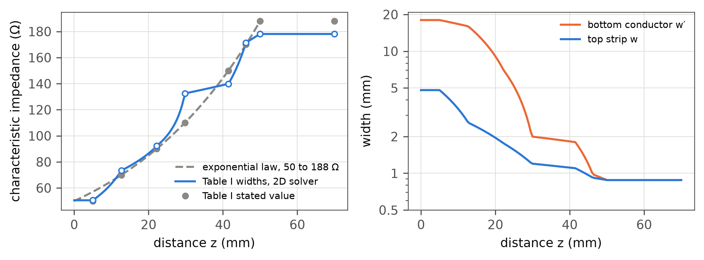
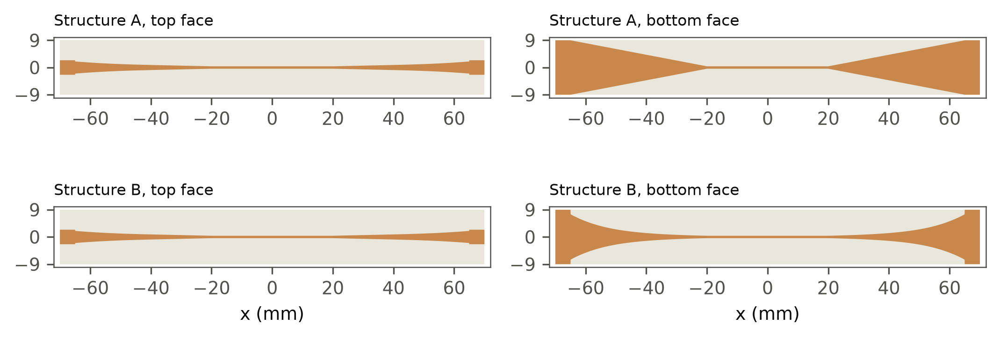
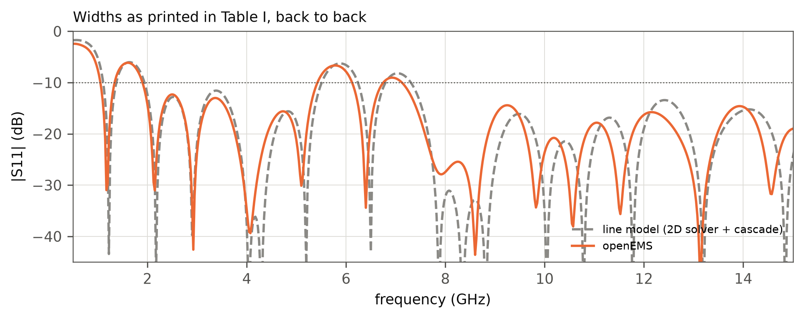
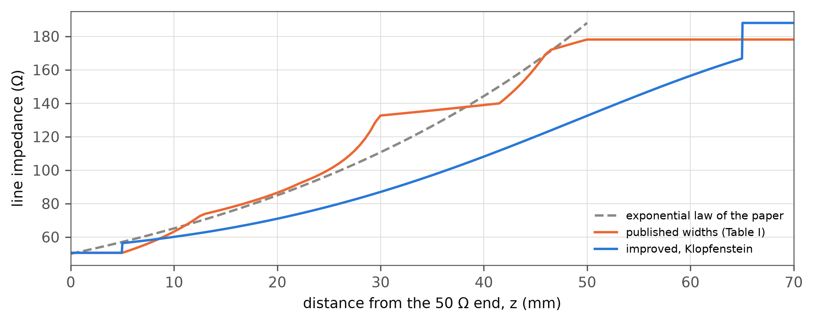
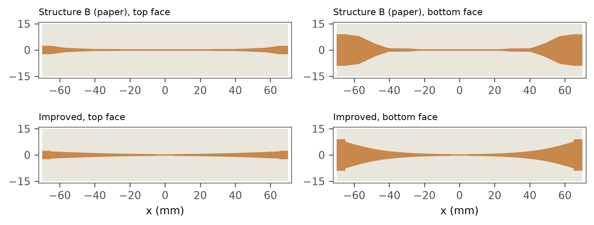
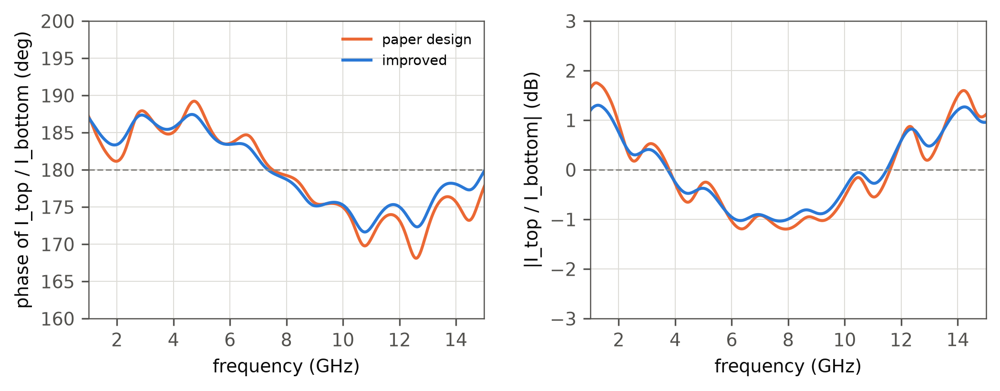
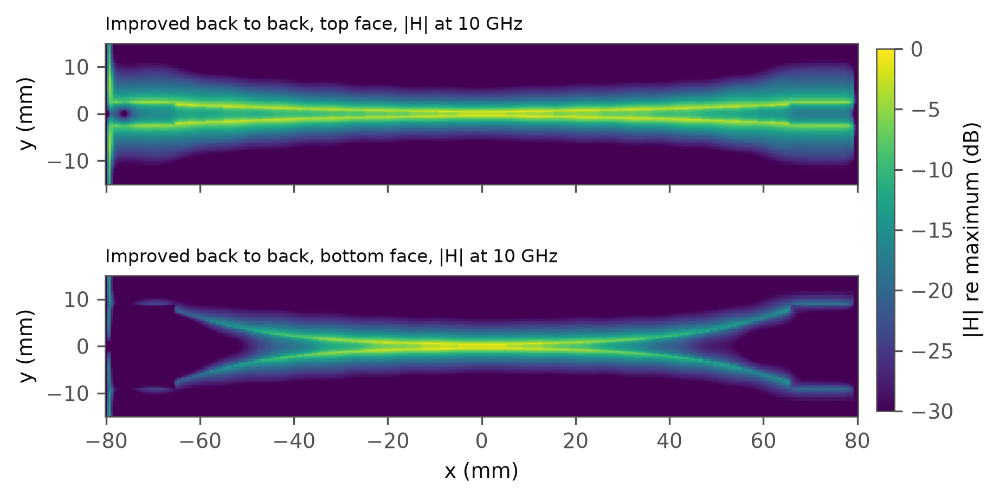

# Abstract

This project reproduces the tapered microstrip to parallel strip balun of Vinayagamoorthy, Coetzee and Jayalath [1] in the FDTD solver openEMS and then improves it. The balun is printed on RT/duroid 5880 ($\varepsilon_r = 2.2$, $h = 1.5748$ mm) and transforms 50 Ω to 188 Ω over 70 mm. Built to the impedance profile of the paper, our model keeps the back-to-back $|S_{11}|$ below $-10$ dB from 1.78 GHz to 15 GHz, against 1.75 GHz to 15 GHz in the paper, and reproduces the paper's current balance, surface current, insertion loss, structure A comparison and balanced section test. The paper's spiral antenna, modelled together with the balun, is matched from 1.75 GHz to 15 GHz apart from a rise to $-9.4$ dB near 13.8 GHz (2.5 GHz to 15 GHz measured in [1]); its 10 GHz pattern follows the simulated pattern of the paper, and its E-plane beamwidth is within 3.7° of the paper's from 2 GHz to 6 GHz. A cross-section solver written for the project shows that two rows of the paper's dimension table do not give the impedance the table states. The improved balun uses a Klopfenstein taper whose every cross-section is solved for its impedance. On the same board it is matched back to back from 1.17 GHz and as a single balun from 0.95 GHz, so it covers the L, S, C and X bands, with better current balance and lower loss.

# Introduction

A balun connects an unbalanced line, such as a coaxial cable or a microstrip, to a balanced load, such as a dipole or a spiral antenna, whose two terminals carry equal and opposite currents. Without one, part of the current returns on the outside of the feed cable, which radiates and distorts the pattern.

The L, S, C and X bands together run from 1 GHz to 12 GHz, a twelve-to-one range. Marchand and transformer baluns cover about an octave. A tapered transition has no resonant length: its lower frequency is set by the taper length and its upper frequency only by the precision of the geometry. Following the course instructions, we chose a published tapered balun [1], reproduced its results in simulation and then improved it, with the aim of covering the whole L band from 1 GHz without enlarging the board.

# Base paper and design specification

In [1] the balun feeds a two-arm Archimedean spiral. One end is a 50 Ω microstrip line for an SMA connector. Along the balun the ground under the strip narrows until it is as wide as the strip, so that the two conductors form a 188 Ω parallel strip line, the input impedance of a self-complementary spiral. The impedance follows an exponential law along the taper (Fig. 2(a) of [1]), and Table I of [1] gives the widths at seven points. Structure B has this outline; structure A has the same top strip with a different ground.

Table: Table 1. Specification of the base design [1].

| quantity | value |
|---|---|
| substrate | RT/duroid 5880, $\varepsilon_r = 2.2$, $h = 1.5748$ mm |
| ports | 50 Ω microstrip to 188 Ω parallel strip |
| impedance profile | exponential, 50 Ω to 188 Ω |
| length × width of one balun | 70 mm × 18 mm |
| structure B, back to back | $\lvert S_{11}\rvert < -10$ dB from 1.75 to 15 GHz, insertion loss below 3 dB |
| structure A, back to back | 2 to 14.3 GHz |
| simulation tool in [1] | CST Microwave Studio |

Table: Table 2. Dimensions of structure B, Table I of [1]. $z$ is the distance from the 50 Ω end, $w$ the top strip width and $w'$ the bottom conductor width.

| $z$ (mm) | $w$ (mm) | $w'$ (mm) | impedance (Ω) |
|---:|---:|---:|---:|
| 5 | 4.8 | 18 | 50 |
| 12.7 | 2.6 | 16 | 70 |
| 22.2 | 1.76 | 7 | 90 |
| 29.8 | 1.2 | 2 | 110 |
| 41.5 | 1.1 | 1.8 | 150 |
| 46.2 | 0.92 | 0.98 | 170 |
| 50 | 0.88 | 0.88 | 188 |
| 70 | 0.88 | 0.88 | 188 |

The stated impedances follow $Z(z) = 50\,(188/50)^{z/50}$ Ω exactly. Quantities the paper does not give were fixed as follows for all runs: loss tangent 0.0009 and 35 µm copper from the substrate data sheet [7], an 18 mm wide board, the two baluns of the back-to-back test joined at $z = 70$ mm, and microstrip ports at the board edges in place of the SMA connectors.

# Theory

## Microstrip and parallel strip lines

The impedance of a microstrip line over a wide ground follows from the closed-form expressions of Hammerstad and Jensen [4]; on this substrate a 50 Ω line is 4.85 mm wide. In a parallel strip line the plane midway between the strips is at zero potential, so

$$ Z_{\text{ps}}(w, h) = 2\, Z_{\text{ms}}(w, h/2). $$

A self-complementary two-arm antenna has an input impedance of $\eta_0/2 \approx 188$ Ω independent of frequency [8], which sets the balanced port impedance.

## Reflection from a taper

Each cross-section of the balun is a two-conductor line with impedance $Z(z)$ and effective permittivity $\varepsilon_{\text{eff}}(z)$. By the theory of small reflections [2]

$$ \Gamma(f) = \frac{1}{2} \int_0^L e^{-2j\phi(z)} \, \frac{d}{dz} \ln Z(z) \, dz, \qquad \phi(z) = \int_0^z \frac{2\pi f}{c} \sqrt{\varepsilon_{\text{eff}}(z')} \, dz'. $$

For an exponential taper this gives

$$ |\Gamma| = \frac{1}{2} \ln\frac{Z_L}{Z_0} \left| \frac{\sin \beta L}{\beta L} \right| , $$

which for 50 Ω to 188 Ω falls below $-10$ dB once $\beta L \geq 1.95$.

The Klopfenstein taper [3] gives the lowest passband reflection for a given length:

$$ \ln Z(z) = \frac{1}{2}\ln(Z_0 Z_L) + \frac{\Gamma_0}{\cosh A} A^2 \, \varphi\!\left(\frac{2z}{L} - 1, A\right), \qquad \varphi(x, A) = \int_0^x \frac{I_1\left(A\sqrt{1-y^2}\right)}{A\sqrt{1-y^2}} \, dy, $$

with $\Gamma_0 = \frac{1}{2}\ln(Z_L/Z_0)$ and $\cosh A = \Gamma_0/\Gamma_m$. Its reflection

$$ \Gamma(\beta L) = \Gamma_0 \, e^{-j\beta L} \, \frac{\cos\sqrt{(\beta L)^2 - A^2}}{\cosh A} $$

stays at or below the ripple $\Gamma_m$ for all $\beta L \geq A$.

## Back-to-back measurement

A balun has one balanced port, so [1] measures two baluns joined at their balanced ends. The reflections of the two arrive with opposite sign and a delay, so that

$$ |S_{11}| \approx |\Gamma_1| \, \left|1 - e^{-2j\beta d}\right| \leq 2|\Gamma_1|, $$

which makes the back-to-back test stricter than a single balun.

# Tools and method

## openEMS

The full-wave simulations use openEMS [5], a finite-difference time-domain solver on a Yee grid [6], driven from MATLAB. A script writes the geometry from a table of $(z, w, w')$ points, the materials, the mesh and the ports; the solver runs with a Gaussian pulse; a second script computes the S-parameters, the current in each strip at the middle of the balanced section and the surface fields. A uniform 50 Ω line with the same settings gives a line impedance of 50.9 Ω to 53.2 Ω and $|S_{11}|$ below $-31.7$ dB from 1 GHz to 15 GHz.

Table: Table 3. Simulation settings.

| item | setting |
|---|---|
| excitation | Gaussian pulse, 0.5 to 16 GHz |
| conductors | 35 µm copper, $\sigma = 5.8 \times 10^7$ S/m |
| substrate | $\varepsilon_r = 2.2$, loss tangent 0.0009 |
| mesh | 0.08 mm at the strips, 0.4 mm along the line, six cells through the substrate |
| boundaries | 8-cell perfectly matched layer [9], 20 mm of air |
| ports | microstrip ports at the board edges; 188 Ω lumped port for a single balun |
| stopping rule | field energy 50 dB below its peak |
| model size | 1.8 to 3.1 million cells, 3 to 10 minutes per run on 16 threads |
| antenna model | spiral and balun together, 0.1 mm cells at the centre of the spiral, 40 mm of air, 50 Ω lumped port at the balun edge, 20 million cells, 1.7 hours per run |

## Cross-section solver and line model

A quasi-static finite-difference solver written for the project computes the capacitance of each cross-section with and without the substrate, giving

$$ Z_0 = \frac{1}{c\sqrt{C\,C_a}}, \qquad \varepsilon_{\text{eff}} = \frac{C}{C_a}. $$

It agrees with the closed-form expressions to within 1.2 per cent (Table 4). Cascading the cross-sections as short uniform lines gives a transmission-line model of the whole balun that runs in a fraction of a second.

Table: Table 4. Cross-section solver against closed-form expressions [4].

| line | $Z_0$ solver (Ω) | $Z_0$ closed form (Ω) | $\varepsilon_{\text{eff}}$ solver | $\varepsilon_{\text{eff}}$ closed form |
|---|---:|---:|---:|---:|
| microstrip, $w$ = 4.8 mm | 50.11 | 50.42 | 1.883 | 1.880 |
| microstrip, $w$ = 2.6 mm | 72.84 | 73.45 | 1.818 | 1.816 |
| microstrip, $w$ = 1.2 mm | 106.19 | 107.33 | 1.757 | 1.753 |
| parallel strip, $w$ = 0.88 mm | 178.08 | 180.19 | 1.784 | 1.781 |

# Validation of the base paper

## Impedance of the published cross-sections

Table 5 gives the impedance of each row of Table I of [1] from the cross-section solver. Four rows are within 5 per cent of the stated value. The rows at $z = 29.8$ mm and $z = 41.5$ mm give 132.5 Ω and 139.9 Ω instead of 110 Ω and 150 Ω; with a 1.2 mm top strip, 110 Ω needs a 6.3 mm bottom conductor, not 2 mm. The 0.88 mm parallel strip gives 178 Ω; 188 Ω needs 0.786 mm.

Table: Table 5. Impedance of the published cross-sections from the cross-section solver.

| $z$ (mm) | $w$ (mm) | $w'$ (mm) | stated (Ω) | computed (Ω) | difference |
|---:|---:|---:|---:|---:|---:|
| 5 | 4.8 | 18 | 50 | 50.6 | +1.2 % |
| 12.7 | 2.6 | 16 | 70 | 73.4 | +4.9 % |
| 22.2 | 1.76 | 7 | 90 | 92.3 | +2.5 % |
| 29.8 | 1.2 | 2 | 110 | 132.5 | +20.5 % |
| 41.5 | 1.1 | 1.8 | 150 | 139.9 | −6.7 % |
| 46.2 | 0.92 | 0.98 | 170 | 171.4 | +0.8 % |
| 50 and 70 | 0.88 | 0.88 | 188 | 178.1 | −5.3 % |

We therefore built structure B to the impedances the table states: from $z = 5$ mm to $z = 50$ mm the line follows $Z(z) = 50\,(188/50)^{z/50}$ Ω, and at every 0.5 mm the widths were solved with the cross-section solver, with the ground-to-strip width ratio falling smoothly from 3.75 at the feed to 1 at the parallel strip, as in Section 6.2. The parallel strip is 0.786 mm wide, so that it is 188 Ω as the paper intends. This is the paper design in the rest of this report.

## Structure B back to back

![Structure B back to back: openEMS result of the paper design, openEMS result with the widths as printed in Table I, and the simulated (CST) and measured $|S_{11}|$ of Fig. 7(d) of [1].](../results/figures/fig_b2b_paper_B.png)

The paper design keeps $|S_{11}|$ below $-10$ dB from 1.78 GHz to 15 GHz, against 1.75 GHz to 15 GHz in [1], and follows the shape of the paper's CST curve; above 2 GHz the highest ripple peak is $-11.0$ dB, at 3.15 GHz. $|S_{21}|$ is never below $-0.98$ dB from 1.75 GHz to 15 GHz, inside the 3 dB of [1]. With every cell 1.5 times smaller (6.7 million cells) the band starts at 1.77 GHz, $|S_{21}|$ changes by at most 0.12 dB and the phase error by 0.15°, so the mesh is fine enough.

With the widths exactly as printed, two extra peaks appear, $-6.7$ dB at 5.42 GHz to 6.10 GHz and $-9.0$ dB at 6.78 GHz to 7.13 GHz. The transmission-line model built from the same cross-sections predicts both (figure below). They come from the two inconsistent rows: the impedance rises quickly near $z = 30$ mm and near $z = 45$ mm, and the two rises, 18 mm apart, reflect in phase near $c / (2 \times 18\ \text{mm} \times \sqrt{1.8}) \approx 6.2$ GHz.

## Structure A

Structure A has the same top strip over a ground that narrows linearly from 18 mm to 0.786 mm, as in the photograph of Fig. 7(b) of [1]. Its $|S_{11}|$ rises to $-6.9$ dB between 2.88 GHz and 3.55 GHz and to $-9.6$ dB between 5.55 GHz and 5.80 GHz, so it meets the $-10$ dB limit on 92.7 per cent of 1.75 GHz to 15 GHz against 99.6 per cent for structure B. As in [1], structure B is the better design, and the first peak of structure A is at the frequency of the first peak in Fig. 7(c) of [1].

![Structure A back to back: openEMS result and the simulated and measured $|S_{11}|$ of Fig. 7(c) of [1].](../results/figures/fig_b2b_paper_A.png)

## Current balance and surface current

From 1.75 GHz to 15 GHz the currents in the two strips of the balanced section stay within 8.8° of 180° and within 1.34 dB of each other, and the common-mode current $(I_{\text{top}} + I_{\text{bot}})/2$ is at least 21.8 dB below the differential current; Fig. 5 of [1] shows 180°. At 2.5 GHz the surface current is symmetric about the centre line (figure below), as in Fig. 6 of [1]: on the wide ground it flows under the strip, and as the ground narrows it moves to the edges until both faces carry the same distribution.

## Length of the balanced section

[1] reports that the response does not change when the parallel strip between the baluns is lengthened. We simulated the paper design with 40 mm and 4 mm of parallel strip between the two baluns. Both are matched across the band: $|S_{11}|$ stays below $-10$ dB from 1.78 GHz and from 1.56 GHz to 15 GHz. $|S_{21}|$ differs by at most 0.69 dB, and $|S_{11}|^2 + |S_{21}|^2$, the power that is neither radiated nor dissipated, agrees within 0.43 dB; above 10 GHz the long version is 0.11 dB lower on average, the loss of the extra 36 mm of line. A longer balanced section adds no radiation of its own, as [1] reports.

## Spiral antenna fed by the balun

The spiral of [1] has two arms of eight turns on a 60 mm × 60 mm board of the same substrate, with arm width, gap and inner radius of 0.86 mm and an outer radius of 28.3 mm. As in Fig. 9 of [1], we modelled the spiral and the balun together: the balun board stands under the centre of the spiral board, its two strips continue through the spiral board and join the inner ends of the arms on the top face, and the 50 Ω end is fed by a lumped port at the lower edge of the balun board. The model has 20 million cells, 0.1 mm at the centre of the spiral, with 40 mm of air on every side; the field energy fell 40 dB in 1.7 hours.

The antenna is below $-10$ dB from 1.75 GHz to 15 GHz except between 13.65 GHz and 13.90 GHz, where $|S_{11}|$ reaches $-9.4$ dB; [1] measured 2.5 GHz to 15 GHz. From 2 GHz to 5 GHz our curve follows the measured curve of [1], including its deep minimum near 3.5 GHz. The spiral alone, fed by 188 Ω across the arm ends, is matched from 1.65 GHz, close to the 1.69 GHz at which [1] puts its largest arm circumference at one wavelength.

![Input $|S_{11}|$ of the spiral antenna at the 50 Ω connector with the paper's balun and with the improved balun, and the simulated and measured curves of Fig. 10 of [1].](../results/figures/fig_spiral_s11.png)

The spiral radiates on both sides of its board. Up to 10 GHz the two lobes along its axis are within 1.2 dB of each other, as in Fig. 11 of [1]. Table 6 gives the beamwidth as CST reports it, the width of the strongest lobe of each cut 3 dB below its peak.

Table: Table 6. Half-power beamwidth of the spiral in the xz plane (E) and the yz plane (H), Table III of [1] and our model. The last column gives the side of the strongest lobe: front is away from the balun.

| $f$ (GHz) | [1], E | ours, E | [1], H | ours, H | strongest lobe |
|---:|---:|---:|---:|---:|---|
| 2 | 94.6° | 97.3° | 81.8° | 93.8° | front |
| 2.5 | 93.5° | 94.4° | 78.5° | 95.2° | front |
| 3 | 86.4° | 85.8° | 78.3° | 81.9° | back |
| 4 | 73.3° | 73.3° | 70.2° | 76.1° | back |
| 5 | 64.9° | 62.2° | 67.1° | 64.9° | back |
| 6 | 61.0° | 57.3° | 60.7° | 59.2° | back |
| 10 | 53.8° | 64.5° | 47.3° | 76.3° | back |
| 15 | 42.6° | 24.2° | 34.4° | 22.5° | back |

From 2 GHz to 6 GHz our E-plane beamwidth is within 3.7° of Table III, and from 3 GHz to 6 GHz the H-plane is within 6°. At 2 GHz and 2.5 GHz our H-plane beam is 12° and 17° wider than in [1].

At 10 GHz, [1] also shows its simulated pattern (Fig. 11). We read it from the figure: the front lobe is 66.8° wide and the back lobe 82.6°. Our yz cut follows it within 2.4 dB rms, with a front lobe of 66.9° and a back lobe of 76.3°, and like Fig. 11 it falls by more than 10 dB near the plane of the spiral. Table III gives 53.8° and 47.3° at 10 GHz, narrower than either lobe of the pattern in Fig. 11, so the 10 GHz row of Table III does not describe that pattern. At 15 GHz the strongest lobe of our model points along the balun and is 24° wide, against 42.6° and 34.4° in Table III; [1] shows no pattern at 15 GHz. In both models the beam narrows as the frequency rises, and our peak directivity rises from 3.5 dBi at 2 GHz to 6.6 dBi at 10 GHz.

![Normalised far field of the antenna at 10 GHz in the xz and yz planes, over the simulated pattern of Fig. 11 of [1].](../results/figures/fig_spiral_pattern_10GHz.png)

## Summary of the validation

Table: Table 7. Results of [1] and the corresponding results of this project.

| result in [1] | value in [1] | this project |
|---|---|---|
| structure B back to back, $\lvert S_{11}\rvert < -10$ dB | 1.75 to 15 GHz | 1.78 to 15 GHz |
| insertion loss back to back | below 3 dB | below 0.98 dB |
| structure A back to back | 2 to 14.3 GHz, worse than B | 92.7 % of the band against 99.6 % for B; first peak near 3.3 GHz as in [1] |
| phase difference of strip currents | 180° | 180° ± 8.8°, common mode 21.8 dB down |
| surface current at 2.5 GHz | symmetric | symmetric |
| longer balanced section | no change | matched in both cases; power balance within 0.5 dB |
| spiral antenna, $\lvert S_{11}\rvert < -10$ dB | 2.5 to 15 GHz, measured | 1.75 to 15 GHz, except −9.4 dB at 13.65 to 13.90 GHz |
| spiral pattern at 10 GHz | Fig. 11 | front lobe 66.9° against 66.8°, 2.4 dB rms |
| spiral beamwidths | Table III | E-plane within 3.7° at 2 to 6 GHz, H-plane within 6° at 3 to 6 GHz |
| impedance of the table rows | as stated | two rows inconsistent; corrected design used |

# Improved design

## Aim

The paper design reaches 1.78 GHz, so it covers only the top of the L band. We set out to cover 1 GHz to 15 GHz with the same substrate, the same 70 mm × 18 mm board per balun, the same 5 mm feed line and a 188 Ω balanced output.

## Design

In [1] the taper is 45 mm long and is followed by 20 mm of parallel strip, which does nothing for matching. We made the taper 60 mm long, kept 5 mm of parallel strip, and replaced the exponential profile with a Klopfenstein profile, which reaches a lower frequency for the same length.

The taper was realised point by point. We tabulated the cross-section solver over 780 combinations of top width (0.4 mm to 6 mm) and bottom width (0.4 mm to 24 mm). The ratio of bottom to top width falls from 3.75 at the feed to 1 at the balanced end,

$$ r(u) = \frac{w'}{w} = 1 + 2.75\,(1 - u)^2, \qquad u = \frac{z - 5\ \text{mm}}{60\ \text{mm}} , $$

and at each of 121 points the top width is solved so that the cross-section has the Klopfenstein impedance. The length and ripple were chosen with the transmission-line model (Table 8): we took a 60 mm taper with $\Gamma_m = 0.12$ ($A = 2.393$).

Table: Table 8. Transmission-line model of Klopfenstein tapers: lowest frequency from which $|S_{11}|$ stays below $-10$ dB up to 15 GHz.

| taper length | $\Gamma_m$ | back to back | one balun into 188 Ω |
|---:|---:|---:|---:|
| 45 mm | 0.10 | 1.85 GHz | 1.45 GHz |
| 45 mm | 0.12 | 1.25 GHz | 1.40 GHz |
| 55 mm | 0.12 | 1.25 GHz | 1.15 GHz |
| 60 mm | 0.10 | 1.30 GHz | 1.10 GHz |
| 60 mm | 0.12 | 1.25 GHz | 1.05 GHz |
| 60 mm | 0.15 | 1.20 GHz | 1.00 GHz |

Table: Table 9. Dimensions of the improved balun at selected points. The full outline, 125 points, is in the project files.

| $z$ (mm) | $w$ (mm) | $w'$ (mm) | impedance (Ω) |
|---:|---:|---:|---:|
| 0 to 5 | 4.80 | 18.00 | 50.6 |
| 5 | 4.08 | 15.29 | 56.4 |
| 15 | 3.32 | 9.67 | 64.9 |
| 25 | 2.57 | 5.72 | 78.3 |
| 35 | 2.00 | 3.37 | 97.0 |
| 45 | 1.58 | 2.06 | 120.1 |
| 55 | 1.26 | 1.35 | 144.8 |
| 65 | 1.01 | 1.01 | 166.7 |
| 65 to 70 | 0.786 | 0.786 | 188 |

## Results

The improved design was simulated with exactly the settings used for the paper design, back to back and as a single balun into 188 Ω.

![$|S_{11}|$ of the paper design and of the improved design. Top: back to back, with the CST result of [1]. Bottom: one balun into 188 Ω. The shaded strip is the L band.](../results/figures/fig_compare.png)

Table: Table 10. Paper design and improved design, both simulated in openEMS with the same settings.

| quantity | [1], reported | paper design | improved |
|---|---|---|---|
| back to back, $\lvert S_{11}\rvert < -10$ dB from | 1.75 GHz | 1.78 GHz | 1.17 GHz |
| back to back, worst $\lvert S_{11}\rvert$, 1.75 to 15 GHz | | −9.6 dB | −13.9 dB |
| back to back, lowest $\lvert S_{21}\rvert$, 1.75 to 15 GHz | above −3 dB | −0.98 dB | −0.70 dB |
| one balun, $\lvert S_{11}\rvert < -10$ dB from | | 1.15 GHz | 0.95 GHz |
| one balun, worst $\lvert S_{11}\rvert$, 1.75 to 15 GHz | | −16.2 dB | −18.0 dB |
| phase error of strip currents | | 8.8° | 7.2° |
| common mode below differential mode | | 21.8 dB | 23.5 dB |
| largest share of power lost | | 12.9 % | 11.5 % |
| spiral antenna, $\lvert S_{11}\rvert < -10$ dB | 2.5 to 15 GHz | 1.75 to 15 GHz, except 13.65 to 13.90 GHz | 1.61 to 15 GHz |
| spiral antenna, worst $\lvert S_{11}\rvert$, 2.5 to 15 GHz | below −10 dB | −9.4 dB | −10.2 dB |
| board per balun | 70 mm × 18 mm | 70 mm × 18 mm | 70 mm × 18 mm |

Back to back, the improved pair keeps $|S_{11}|$ below $-10$ dB from 1.17 GHz to 15 GHz, a bandwidth ratio of 12.8 to 1 against 8.6 to 1 in [1], with a worst reflection of $-13.9$ dB above 1.75 GHz and at most 0.70 dB insertion loss. A single improved balun into 188 Ω is matched from 0.95 GHz, so it covers the whole L band, with a worst reflection of $-18.0$ dB from 1.75 GHz to 15 GHz against $-16.2$ dB for the paper design. The strip currents are better balanced (7.2° and 1.04 dB, common mode 23.5 dB down) and less power is lost.

With the improved balun under it, the spiral antenna of [1] is matched from 1.61 GHz to 15 GHz without a break; with the paper design it rises to $-9.4$ dB near 13.8 GHz (spiral figure in Section 5.6). The lower limit is close to the 1.65 GHz of the spiral alone, which is set by its size. The beamwidths with the two baluns differ by at most 2° up to 10 GHz.

# Conclusion

We reproduced the wideband balun of [1] in openEMS. Built to the impedance profile of the paper, it is matched back to back from 1.78 GHz to 15 GHz (1.75 GHz to 15 GHz in [1]) with less than 1 dB insertion loss, and its current balance, surface current, structure A comparison and balanced section test agree with [1]. The paper's spiral antenna with this balun under it is matched from 1.75 GHz to 15 GHz apart from $-9.4$ dB near 13.8 GHz (2.5 GHz to 15 GHz measured in [1]). Its E-plane beamwidth is within 3.7° of Table III of [1] up to 6 GHz, and its 10 GHz pattern follows Fig. 11 of [1]. Our cross-section solver showed that two rows of the paper's Table I do not give their stated impedance, and that built as printed they add two reflection peaks near 6 GHz.

The improved balun spends 60 mm of the same board on a Klopfenstein taper whose every cross-section is solved for its impedance. It is matched back to back from 1.17 GHz and as a single balun from 0.95 GHz, with better balance and lower loss. It covers the L, S, C and X bands, as the project title asks. All results are simulations; fabrication and measurement are the next step.

# References

[1] K. Vinayagamoorthy, J. Coetzee and D. Jayalath, "Microstrip to parallel strip balun as spiral antenna feed," in *Proc. IEEE 75th Vehicular Technology Conference (VTC Spring)*, Yokohama, 2012, pp. 1-5, doi: 10.1109/VETECS.2012.6240118.

[2] D. M. Pozar, *Microwave Engineering*, 4th ed. Hoboken, NJ: Wiley, 2012, ch. 5.

[3] R. W. Klopfenstein, "A transmission line taper of improved design," *Proc. IRE*, vol. 44, no. 1, pp. 31-35, Jan. 1956.

[4] E. Hammerstad and Ø. Jensen, "Accurate models for microstrip computer-aided design," in *IEEE MTT-S Int. Microwave Symp. Digest*, 1980, pp. 407-409.

[5] T. Liebig, *openEMS: a free and open electromagnetic field solver using the EC-FDTD method*, version 0.37.0. [Online]. Available: https://www.openems.de

[6] K. S. Yee, "Numerical solution of initial boundary value problems involving Maxwell's equations in isotropic media," *IEEE Trans. Antennas Propag.*, vol. 14, no. 3, pp. 302-307, May 1966.

[7] Rogers Corporation, *RT/duroid 5870 and 5880 high frequency laminates*, data sheet.

[8] Y. Mushiake, "Self-complementary antennas," *IEEE Antennas Propag. Mag.*, vol. 34, no. 6, pp. 23-29, Dec. 1992.

[9] J.-P. Bérenger, "A perfectly matched layer for the absorption of electromagnetic waves," *J. Comput. Phys.*, vol. 114, no. 2, pp. 185-200, 1994.

# Appendix: project files

All scripts, geometry tables, results and figures are in the project repository. The MATLAB scripts in `src/` write the openEMS models (`build_balun.m`, `build_spiral.m`) and read the finished runs (`post_balun.m`, `post_spiral.m`). The Python scripts contain the cross-section solver (`xsection.py`), the transmission-line model (`taper.py`), the synthesis of the paper design and the improved taper (`design_improved.py`), the summary of results (`summarize.py`) and the figures (`plots.py`). `geometry/` holds the outline of every simulated structure, and `results/summary.csv` holds every figure of merit quoted in this report.
